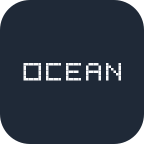
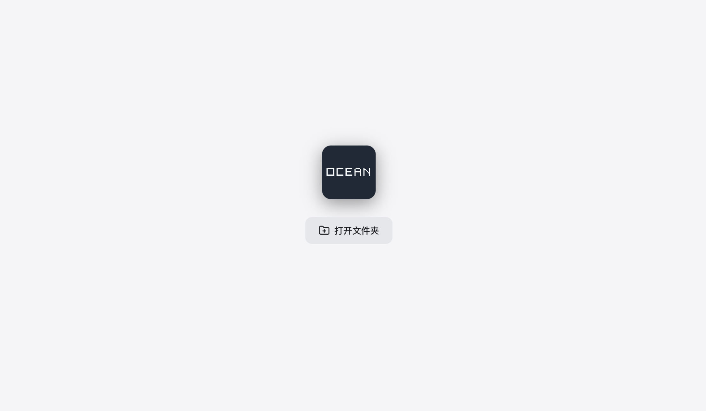
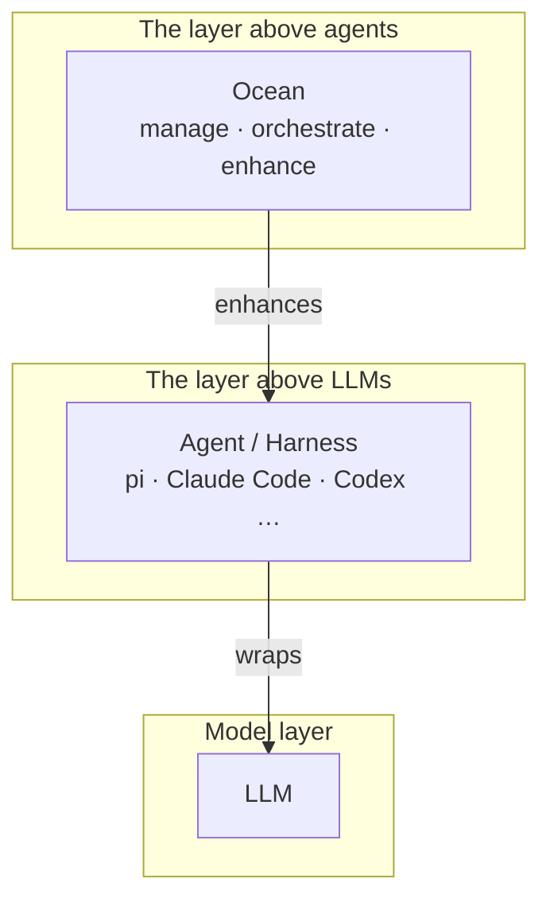
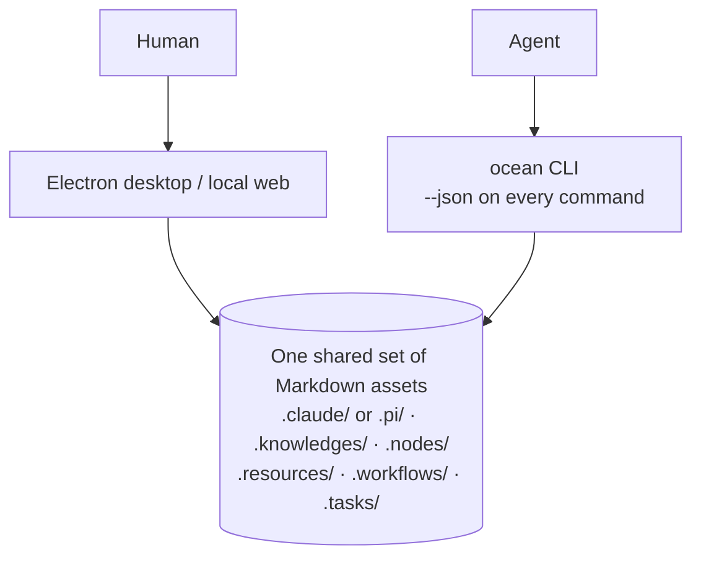
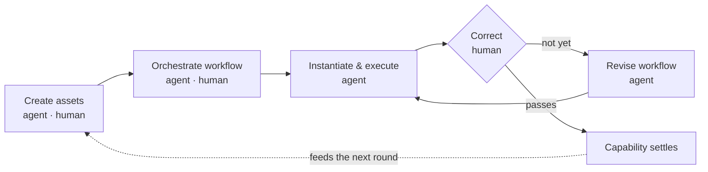

<div align="center">



---

**Agent Harness Enhancement Application**

Agents through the CLI, humans through the GUI. Two entries, one set of Markdown assets -- create, execute, correct, iterate: the loop runs on your machine.

<p align="center">
  <a href="https://opensource.org/licenses/MIT"></a>
  <a href="https://github.com/zhangz1w3nCode/Ocean/releases"></a>
  <a href="https://github.com/zhangz1w3nCode/Ocean/stargazers"></a>
  <a href="https://github.com/zhangz1w3nCode/Ocean"></a>
</p>

[English](./README.md) | [中文](./README_CN.md)

</div>

<p align="center">
  
</p>

---

## Where Ocean Sits



**The harness is to the LLM what Ocean is to the agent.**

A harness wraps the LLM with tools, loops, and context, turning it into an agent that gets real work done; Ocean wraps agents with management and orchestration, letting their capability assets accumulate, compose, and compound.

The enhancement lands in three places:

- **Assets** -- 7 types of capability assets managed in one place, cross-referenced: capabilities have somewhere to accumulate
- **Workflows** -- multi-step agent work becomes instantiable, replayable process: one-off executions turn into reusable capability
- **Iterations** -- humans correct, agents revise, workflows re-run: every round is a version, and capabilities compound

Ocean does not do the harness's job -- it does not wrap LLMs or take over agent runtimes. It occupies exactly one layer: above agents.

## Humans and Agents

Ocean treats both kinds of users as first-class -- different entries, same data:



- **For agents** -- the `ocean` CLI: 8 namespaces covering every asset type and workflow execution, machine-readable output
- **For humans** -- the desktop GUI (and local web): visual editing, knowledge graph, drag-and-drop orchestration
- **One set of data** -- both entries operate on the same Markdown files; edit them with any text editor and Ocean picks them up. Zero data lock-in.

## Self-Iteration

The real value of two entries is this loop:



Agents create assets, orchestrate workflows, instantiate, execute, and revise against corrections; humans step in only at the hinge -- judging results and issuing corrections. Every round is a version: revisions land as changes to Markdown files and meta-data/flow.json, artifacts are kept as v1 / v2 / v3, trace.jsonl records the whole run, and the workflow is re-instantiated until it passes. Whatever passes settles into assets and feeds the next round.

Enhancement is not a one-time deliverable -- it is the byproduct of this loop turning.

## Why Ocean

Harnesses turned LLMs into agents, but nobody owns the agents' capabilities: skills scattered across `.pi/skills/`, agent definitions scattered across `.claude/agents/`, and knowledge, nodes, resources, and workflows each in their own silos with no cross-references. The more agents you run, the less your capabilities compound.

Ocean fills this layer, turning those scattered Markdown files into a coherent, manageable system:

- **Reference, not copy** -- Assets are linked through `@` references and `%` WikiLinks instead of being duplicated. A single source of truth means editing a shared asset or knowledge entry automatically reflects everywhere it is referenced.
- **Knowledge as a graph** -- Knowledge entries are stored as individual Markdown files and connected via WikiLinks with labeled relationships. The entire knowledge network is rendered as an interactive force-directed graph where you can click any node to view details, and tune physics parameters like centripetal force and node distance.
- **Zero data lock-in** -- All data is stored as standard Markdown files in the project's asset directories. You can edit them with any text editor, or manage them through Ocean's GUI or CLI.
- **Fully local** -- No cloud services, no accounts, no data uploads. Your assets stay on your machine.
- **Visual orchestration** -- Compose complex workflows by dragging and connecting nodes on a canvas. Each node is interactive -- click to configure, drag to reposition, branch to create decision paths. The visual approach makes multi-step workflows tangible and intuitive to build.

## Asset System

Ocean manages 7 types of agent assets, each with full CRUD, Markdown preview, and reference linking:

| Asset | Storage | Description |
|-------|---------|-------------|
| Agents | `.claude/agents/` or `.pi/agents/` | Agent profiles: model selection, role instructions, custom icons |
| Skills | `.claude/skills/` or `.pi/skills/` | Skill packages with SKILL.md, scripts, references, and examples |
| Knowledge | `.knowledges/` | Business knowledge: tags, categories, domains, WikiLinks, and a visual graph |
| Nodes | `.nodes/` | Reusable workflow building blocks |
| Resources | `.resources/` | Reference resource files |
| Workflows | `.workflows/` | Workflow definitions, local nodes, instances, and artifacts |
| Tasks | `.tasks/` | Task library: tasks, contexts, and processing timelines |

Agents and skills are loaded from a switchable asset source (Settings > Asset Source, `.claude/` or `.pi/`); the rest live in project-level shared directories; `.ocean/` holds project-level configuration.

## Features

### Asset Management & Cross-Asset References

- **`@` reference** -- Type `@` in the Markdown editor to reference any asset. References are stored as file paths, not copies; when the source asset updates, every reference stays in sync.
- **`%` WikiLink** -- Type `%` to insert a WikiLink (`[[file.md|relation]]`) that creates bidirectional links between knowledge entries, visualized in the knowledge graph.

Every piece of content exists in exactly one place: no version drift, no stale copies. Each improvement to a shared asset compounds across the whole system -- the more you reference, the greater the return.

### Workflows: Orchestration & Execution

- Drag-and-drop flow editor built on React Flow: 6 node types (Start, End, Process, Decision, Business, Local), Dagre auto-layout, grid snapping, multi-select, copy/paste, context menu
- Decision-node branch management with dynamic output handles
- Instance execution: progress graph (follow mode, ghost pre-render of candidate successors), trace timelines, browser-style instance tabs
- Artifacts: card grid, search, versioning, and diff comparison
- LLM-based artifact review at the `complete` stage
- Generates structured WORKFLOW.md output with Mermaid flowcharts and step-by-step execution paths

### Knowledge: Graph, Catalog & Review

- Force-directed knowledge graph (D3-force): dynamic node sizing, relationship labels, in/out-degree coloring, tunable physics
- Knowledge catalog page: nested sidebar layout, WYSIWYG live rich-text editing (mermaid block rendering)
- Related-knowledge mini graph side panel: recomputed on the local subgraph, viewport-fitted after force convergence
- Knowledge review workflow: `.knowledges/` as an independent git repository, review branch pinned to `ocean-knowledge`
- Knowledge domains and CLI search

### Task Library

- Task management: linked-task multi-select, capsule input, full CRUD
- Task context read/write and trace
- Processing timeline: ReactFlow horizontal node-chain graph with click-to-highlight and detail panels
- Equivalent CLI capability (`ocean task`)

### AI-Powered Content Creation

- **Manual creation** -- Write content directly
- **LLM creation** -- Generate content using AI with customizable prompt templates
- **Agentic creation** -- AI autonomously creates content using tools and file system access
- Agentic toolset: `file-read`, `file-write`, `file-edit`, `bash-execute`
- 9 LLM providers: OpenAI, Anthropic, Azure, Google, Groq, xAI, Mistral, OpenRouter, plus OpenAI-compatible custom endpoints
- Content optimization with git diff-style comparison

### Markdown Editor & Rendering

- CodeMirror 6-based Markdown editor with syntax highlighting and `@`-mention completion
- GitHub Flavored Markdown rendering (tables, strikethrough, task lists)
- Mermaid diagram rendering
- Code block syntax highlighting (highlight.js)
- Rehype-raw for embedded HTML support

## Ocean CLI

The unified entry for agents, operating on the same assets as the GUI:

| Namespace | Capabilities |
|-----------|--------------|
| `workflow` | Workflow CRUD, graph editing, instance execution (next / complete / fail / choose / status), artifact queries (versioning / diff / timeline), local nodes |
| `knowledge` | Knowledge CRUD, search, domain management |
| `task` | Task CRUD, context, trace, search |
| `node` / `resource` / `agent` / `skill` | CRUD for each |
| `config` | Asset source configuration |

Every command supports `--json` (machine-readable) and `--help`; table output is unified via cli-table3.

Installation: one click in the desktop app (Settings > CLI Agent) -- writes an `ocean` wrapper (to `/usr/local/bin` first, then `/opt/homebrew/bin`, falling back to `~/.ocean/bin` with automatic PATH configuration).

```bash
ocean workflow list --json
ocean knowledge search "architecture"
ocean task read <task-name>
```

## Web Mode (Personal, Local)

Without changing a line of `electron/launch.cjs`, a plain node process loads the same 91 IPC handlers and serves the browser over HTTP + SSE.

```bash
pnpm web:build   # build the frontend (= pnpm build)
pnm web:serve   # start http://127.0.0.1:8787 manually (dist/ + API + SSE)
pnm web:dev     # dev mode: vite(5273) + API(8787), hot reload on frontend changes
```

You can also toggle hosting from the desktop app (Settings > General > Web Access). The toggle is project-level, persisted in `<project>/.ocean/setting/general.json`. Note: the toggle and a manual `pnpm web:serve` share port 8787 -- never enable both at once. The server binds to `127.0.0.1` only, with no authentication: strictly for personal local use; do not expose it to the public internet.

## Tech Stack

| Category | Technology | Version |
|----------|-----------|---------|
| Framework | React | 19.2 |
| Language | TypeScript | 5.9 |
| Build Tool | Vite | 5.4 |
| Desktop | Electron | 40.4 |
| App Packaging | electron-builder | 26.7 |
| CLI Build | esbuild | 0.28 |
| Styling | Tailwind CSS | 3.4 |
| Animation | Framer Motion | 12.34 |
| Icons | Lucide React | 0.563 |
| State Management | Zustand | 5.0 |
| Flow Editor | @xyflow/react (React Flow) | 12.10 |
| Auto Layout | @dagrejs/dagre | 2.0 |
| Force Graph | D3-force + react-force-graph-2d | 3.0 / 1.29 |
| Code Editor | CodeMirror 6 (@uiw/react-codemirror) | 4.25 |
| Rich Text Editing | @atomic-editor/editor | 0.6 |
| Markdown Rendering | react-markdown + remark-gfm + rehype-highlight | 10.1 |
| Diff View | react-diff-viewer-continued | 4.4 |
| Diagrams | Mermaid | 11.12 |
| Drag & Drop | @dnd-kit | 6.3 / 10.0 |
| Frontmatter | yaml | 2.9 |
| CLI Tables | cli-table3 | 0.6 |
| Testing | Vitest | 2.1 |
| Package Manager | pnpm | 10.19 |

## Getting Started

### Prerequisites

- **Node.js** >= 18
- **pnpm** >= 8 (recommended: 10.19+)

### Installation

```bash
git clone https://github.com/zhangz1w3nCode/Ocean.git
cd Ocean
pnpm install
```

### Development

```bash
pnpm dev           # start the Vite dev server (web mode, http://localhost:5173)
pnpm electron:dev  # start Electron dev mode (desktop app + hot reload)
```

### Build

```bash
pnpm build          # build web assets (dist/)
pnpm electron:build # build and package the Electron app (includes the ocean CLI)
```

Build outputs:
- **Web**: `dist/`
- **macOS**: `release/` (DMG for Apple Silicon arm64)
- **Windows**: `release/` (NSIS installer for x64)

The packaged CLI lives at `Resources/cli/bin/ocean.js` inside the app.

## Project Structure

```
Ocean/
├── electron/                    # Electron main process & Node side
│   ├── launch.cjs               # Main process entry (91 IPC handlers)
│   ├── preload.dev.cjs          # Preload script (exposes electronAPI)
│   ├── bin/ocean.ts             # ocean CLI entry
│   ├── core/                    # CLI core logic
│   │   ├── executor.ts          # Workflow execution engine
│   │   ├── artifact_query.ts    # Artifact queries (versioning / diff / timeline)
│   │   ├── llm_review.ts        # LLM artifact review
│   │   ├── taskStore.cjs        # Shared task storage (GUI & CLI)
│   │   └── …                    # workflow / knowledge / node / resource / agent / skill / task
│   ├── server/                  # Web mode (HTTP + SSE, reuses IPC handlers)
│   └── tools/                   # Agent tool adapters (bash / read / write / edit)
├── src/
│   ├── pages/                   # 16 pages: assets ×6, knowledge ×3, workflows ×2, task library, flow editor, settings ×2, project selection
│   ├── components/              # agent / flow / knowledge / layout / node / resource / settings / skill / tasks / ui / workflow
│   ├── hooks/                   # useAgentLoop / useAgenticExecutor / useKnowledgeGraph / useReferenceItems
│   ├── services/                # llmService (9 providers, IPC to main process) / agentLoopService
│   ├── stores/                  # Zustand state (13 stores)
│   ├── types/                   # TypeScript types
│   └── utils/                   # Utilities (storage, asset source, workflow generation, graph parsing)
├── assets/                      # README images (logo, screenshots)
├── build/                       # Build assets (app icons)
└── package.json · vite.config.ts · tailwind.config.ts · tsconfig.json
```

## Data Storage

All data is stored as plain Markdown files (with optional YAML Frontmatter) inside the project directory:

```
your-project/
├── .claude/  (or .pi/)          # Asset-source root (switchable in Settings)
│   ├── agents/                  # Agent definitions (*.md)
│   └── skills/                  # Skill packages (directory per skill)
├── .knowledges/                 # Knowledge entries (*.md), independent git repo, reviews on the ocean-knowledge branch
├── .nodes/                      # Node definitions (*.md) -- shared
├── .resources/                  # Resource files (*.md) -- shared
├── .workflows/                  # Workflow definitions -- shared
│   └── workflow-name/
│       ├── WORKFLOW.md          # Generated workflow document
│       ├── meta-data/
│       │   └── flow.json        # Graph structure (nodes & edges)
│       ├── nodes/               # Local nodes (local type)
│       └── instance/            # Instances (one directory per instance)
│           └── {instance-id}/
│               ├── instance.md  # Snapshot of WORKFLOW.md
│               ├── status.json  # Execution state (authoritative source)
│               ├── process.md   # Human-readable execution trace
│               ├── context.md   # Stashed context
│               ├── trace/
│               │   └── trace.jsonl   # Structured trace log
│               └── artifacts/
│                   └── {node}/{invoke}/v{N}/detail.md   # Versioned artifacts
├── .tasks/                      # Task library
└── .ocean/                      # Project-level configuration (asset source, settings)
```

Each asset is a standard Markdown file with optional YAML Frontmatter metadata: version it with Git, edit it with any text editor.

## License

[MIT](./LICENSE)
