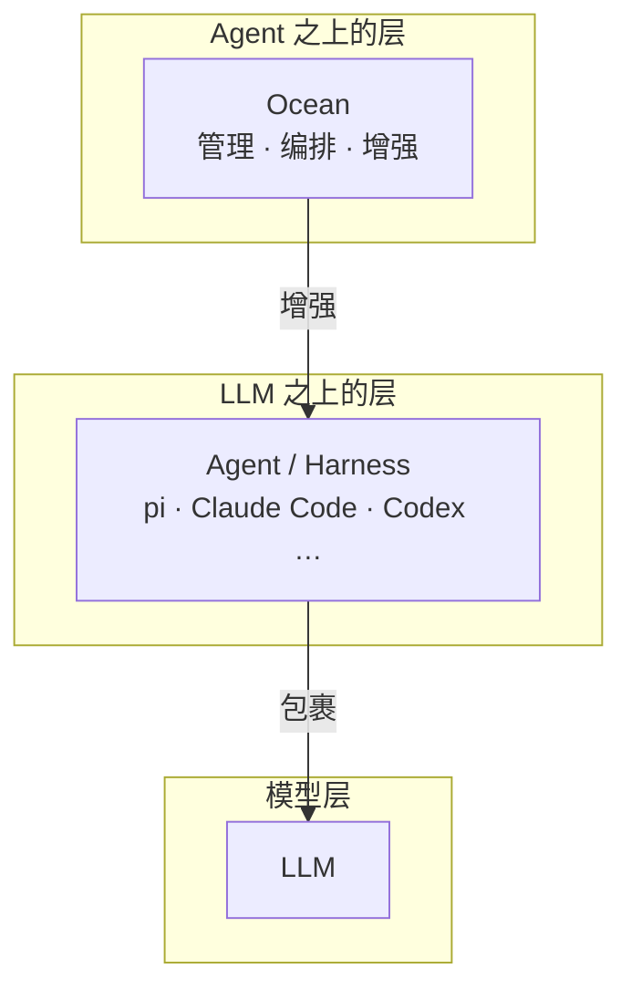
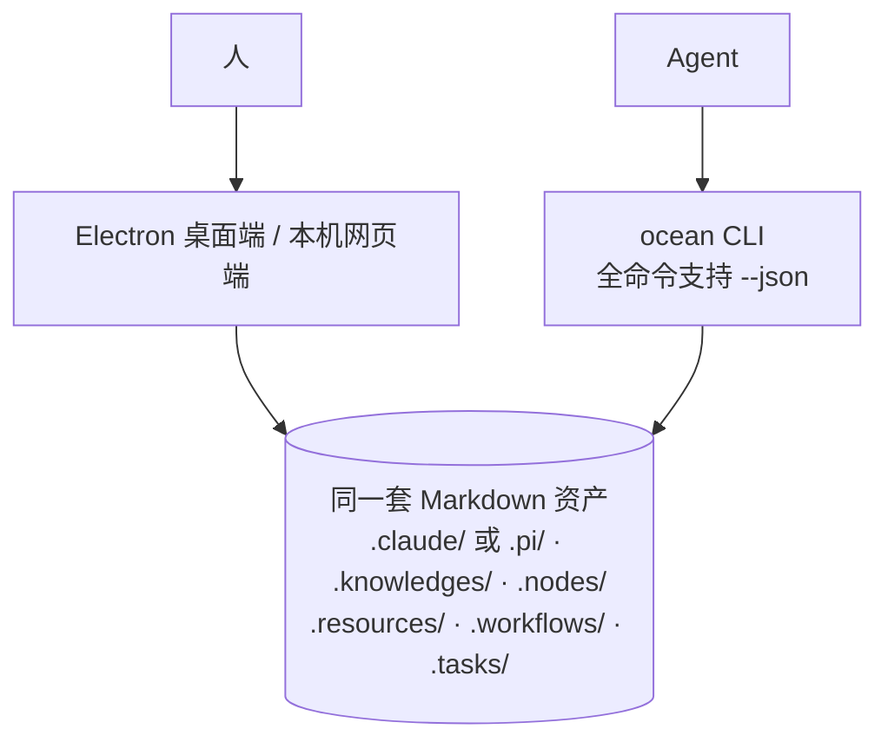
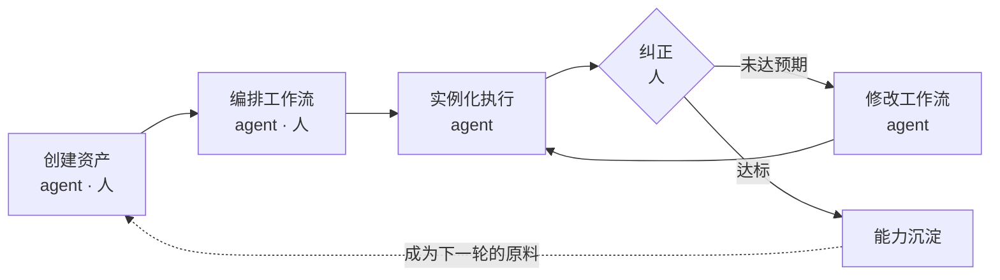

<div align="center">


---

**Agent Harness 增强应用**

Agent 通过 CLI，人通过 GUI。两个入口，一套 Markdown 资产——创建、执行、纠正、迭代，循环发生在你的机器上。

<p align="center">
  <a href="https://opensource.org/licenses/MIT"></a>
  <a href="https://github.com/zhangz1w3nCode/Ocean/releases"></a>
  <a href="https://github.com/zhangz1w3nCode/Ocean/stargazers"></a>
  <a href="https://github.com/zhangz1w3nCode/Ocean"></a>
</p>

[English](./README.md) | [中文](./README_CN.md)

</div>

<p align="center">
  
</p>

---

## Ocean 在哪一层



**Harness 之于 LLM，Ocean 之于 Agent。**

Harness 用工具、循环与上下文包裹 LLM，把它变成能干活的 Agent；Ocean 用管理与编排包裹 Agent，让它的能力资产持续积累、复用、组合。

增强落在三处：

- **资产** —— 7 类能力资产统一管理、相互引用，Agent 的能力有处积累
- **工作流** —— 把多步骤的 Agent 工作编排成可实例化、可重放的流程，一次性执行变成可复用的能力
- **迭代** —— 人纠正、Agent 修改、重新执行，每轮循环都是一次版本，能力复利

Ocean 不做 Harness 的事——不包裹 LLM、不接管 Agent 的运行时。它只占一层：Agent 之上。

## 人和 Agent

Ocean 对两类用户一视同仁——入口不同，数据同源：



- **Agent 的入口** —— `ocean` CLI：8 个命名空间覆盖全部资产与工作流执行，输出机器可读
- **人的入口** —— 桌面 GUI（及本机网页端）：可视化编辑、知识图谱、拖拽编排
- **同一套数据** —— 两个入口操作同一份 Markdown 文件；用任何编辑器直接改，Ocean 照常识别，零数据锁定

## 自我迭代

两个入口的真正价值，是让这个循环转起来：



Agent 创建资产、编排工作流、实例化执行、按纠正意见修改；人只在关键处出手——判断结果、给出纠正。每轮循环都是一次版本：修改物化为 Markdown 文件与 meta-data/flow.json 的变更，产物按 v1 / v2 / v3 留痕，trace.jsonl 记录全程，重新实例化验证，直到达标。达标的能力沉淀为资产，成为下一轮的原料。

增强不是一次性的交付，而是这个循环转动的副产物。

## 为什么需要 Ocean

Harness 把 LLM 变成了 Agent，但没有人为 Agent 的能力负责：技能散落在 `.pi/skills/`，智能体定义散落在 `.claude/agents/`，知识、节点、资源、工作流各自为政、互不引用。Agent 越用越多，能力却无法积累。

Ocean 补上这一层，把这些分散的 Markdown 文件变成一个连贯、可管理的系统：

- **引用而非复制** —— 资产之间通过 `@` 引用和 `%` WikiLink 建立关联，而非复制内容。单一数据源意味着修改一个共享资产或知识条目后，所有引用处自动同步，无需重复维护多份副本。
- **知识图谱化** —— 每条知识以独立 Markdown 文件存储，通过带关系标签的 WikiLink 互联。整个知识网络渲染为可交互的力导向图谱，点击节点即可查看详情，还可调节向心力、节点距离等物理参数。
- **零数据锁定** —— 所有数据以标准 Markdown 文件存储在项目的资产目录中。你可以用任何文本编辑器直接编辑，也可以使用 Ocean 的可视化界面或 CLI 管理。
- **完全本地** —— 没有云服务、没有账号注册、没有数据上传。你的资产始终在你的机器上。
- **可视化编排** —— 在画布上拖拽和连接节点来组合复杂工作流。每个节点可交互 —— 点击配置属性，拖动调整位置，分支创建决策路径。可视化操作让多步骤工作流变得直观可触。

## 资产体系

Ocean 管理 7 类 Agent 资产，每种均支持完整的增删改查、Markdown 预览和引用链接：

| 资产 | 存储位置 | 说明 |
|------|----------|------|
| 智能体 | `.claude/agents/` 或 `.pi/agents/` | 定义 Agent 配置，支持模型选择、角色指令、图标自定义 |
| 技能 | `.claude/skills/` 或 `.pi/skills/` | 以目录结构打包复杂技能，包含 SKILL.md、脚本、参考文档和示例 |
| 知识 | `.knowledges/` | 管理业务知识，支持标签、分类、知识域、WikiLink 引用和可视化知识图谱 |
| 节点 | `.nodes/` | 定义可复用的工作流构建块 |
| 资源 | `.resources/` | 管理参考资源文件 |
| 工作流 | `.workflows/` | 工作流定义、局部节点、实例与产物 |
| 任务 | `.tasks/` | 任务库：任务、上下文与处理时间线 |

智能体和技能从可切换的资产来源加载（设置 > 资产来源，`.claude/` 或 `.pi/`）；其余资产存储在项目级共享目录中；`.ocean/` 存放项目级配置。

## 功能特性

### 资产管理与跨资产引用

- **`@` 引用** —— 在 Markdown 编辑器中输入 `@` 即可引用任意资产。引用以文件路径的形式存储，而非复制内容；源资产更新时，所有引用处自动同步。
- **`%` WikiLink** —— 输入 `%` 插入 WikiLink（`[[file.md|关系]]`），在知识条目之间建立双向链接，并在知识图谱中可视化。

每份内容只存在于一个位置：不会出现版本漂移，不会有陈旧副本。对一个共享资产的每次改进，都会在整个系统中产生复利效应：引用越多，收益越大。

### 工作流：编排与执行

- 基于 React Flow 的拖拽式流程编辑器：6 种节点类型（开始、结束、处理、判断、业务、局部）、Dagre 自动布局、网格吸附、多选、复制粘贴、右键菜单
- 判断节点分支管理与动态输出端口
- 实例执行：执行进度图（跟随模式、候选后继虚化预渲染）、trace 时间线、浏览器式多实例标签页
- 产物系统：卡片网格化展示、搜索、版本化与 diff 对比
- `complete` 阶段 LLM 智能审核产物
- 生成结构化 WORKFLOW.md 文档，包含 Mermaid 流程图和分步执行路径

### 知识：图谱、目录与审核

- 力导向知识图谱（D3-force）：动态节点大小、关系标签、出入度配色、物理参数可调
- 知识目录页：二级侧边栏布局、WYSIWYG 实时富文本编辑（mermaid 代码块渲染）
- 「相关知识」侧滑 mini 图谱：按局部子图重算出入度，力导向收敛后适配视口
- 知识审核流程：`.knowledges/` 独立 git 仓库，审核分支固定为 `ocean-knowledge`
- 知识域管理与 CLI 检索

### 任务库

- 任务管理：关联任务多选、胶囊式输入、完整增删改查
- 任务上下文（context）读写与 trace 追踪
- 处理时间线：ReactFlow 横向节点链图，点击高亮与详情面板
- CLI 端对等能力（`ocean task`）

### AI 驱动的内容创建

- **手动创建** —— 直接编写内容
- **LLM 创建** —— 使用 AI 生成内容，支持自定义提示词模板
- **Agentic 创建** —— AI 自主使用工具和文件系统访问能力创建内容
- Agentic 工具集：`file-read`、`file-write`、`file-edit`、`bash-execute`
- 9 家 LLM 提供商：OpenAI、Anthropic、Azure、Google、Groq、xAI、Mistral、OpenRouter，及 OpenAI 兼容自定义端点
- 内容优化，git diff 风格可视化对比

### Markdown 编辑与渲染

- 基于 CodeMirror 6 的 Markdown 编辑器，支持语法高亮与 `@` 提及补全
- GitHub Flavored Markdown 渲染（表格、删除线、任务列表）
- Mermaid 图表渲染
- 代码块语法高亮（highlight.js）
- 通过 rehype-raw 支持内嵌 HTML

## Ocean CLI

Agent 侧的统一入口，与 GUI 操作同一套资产：

| 命名空间 | 能力 |
|----------|------|
| `workflow` | 工作流增删改查、图编辑、实例执行（next / complete / fail / choose / status）、产物查询（版本化 / diff / timeline）、局部节点 |
| `knowledge` | 知识增删改查、检索、知识域管理 |
| `task` | 任务增删改查、上下文、trace、检索 |
| `node` / `resource` / `agent` / `skill` | 各自的增删改查 |
| `config` | 资产来源配置 |

全命令支持 `--json`（机器可读）与 `--help`；表格输出统一使用 cli-table3。

安装：桌面端「设置 → CLI Agent」一键安装（写入 `ocean` 命令：优先 `/usr/local/bin`，其次 `/opt/homebrew/bin`，兜底 `~/.ocean/bin` 并自动配置 PATH）。

```bash
ocean workflow list --json
ocean knowledge search "架构设计"
ocean task read <任务名>
```

## 网页端（个人本机使用）

不改一行 `electron/launch.cjs`，用纯 node 进程加载同一套 91 个 IPC handler，通过 HTTP + SSE 服务浏览器。

```bash
pnpm web:build   # 构建前端（= pnpm build）
pnpm web:serve   # 手动启动 http://127.0.0.1:8787（托管 dist/ + API + SSE）
pnm web:dev     # 开发模式：vite(5273) + API(8787)，前端改动热更新
```

也可以在桌面端「设置 → 通用 → 网页端访问」用开关托管。开关状态是项目级的，持久化在 `<项目>/.ocean/setting/general.json`。注意：开关托管与手动 `pnpm web:serve` 共用 8787 端口，二者不可同时开启。服务只监听 `127.0.0.1`，无鉴权，仅限个人本机使用；不要暴露到公网。

## 技术栈

| 分类 | 技术 | 版本 |
|------|------|------|
| 框架 | React | 19.2 |
| 语言 | TypeScript | 5.9 |
| 构建工具 | Vite | 5.4 |
| 桌面端 | Electron | 40.4 |
| 应用打包 | electron-builder | 26.7 |
| CLI 构建 | esbuild | 0.28 |
| 样式 | Tailwind CSS | 3.4 |
| 动画 | Framer Motion | 12.34 |
| 图标 | Lucide React | 0.563 |
| 状态管理 | Zustand | 5.0 |
| 流程编辑器 | @xyflow/react (React Flow) | 12.10 |
| 自动布局 | @dagrejs/dagre | 2.0 |
| 力导向图 | D3-force + react-force-graph-2d | 3.0 / 1.29 |
| 代码编辑器 | CodeMirror 6 (@uiw/react-codemirror) | 4.25 |
| 富文本编辑 | @atomic-editor/editor | 0.6 |
| Markdown 渲染 | react-markdown + remark-gfm + rehype-highlight | 10.1 |
| Diff 视图 | react-diff-viewer-continued | 4.4 |
| 图表 | Mermaid | 11.12 |
| 拖拽排序 | @dnd-kit | 6.3 / 10.0 |
| Frontmatter | yaml | 2.9 |
| CLI 表格输出 | cli-table3 | 0.6 |
| 测试 | Vitest | 2.1 |
| 包管理器 | pnpm | 10.19 |

## 快速开始

### 环境要求

- **Node.js** >= 18
- **pnpm** >= 8（推荐 10.19+）

### 安装

```bash
git clone https://github.com/zhangz1w3nCode/Ocean.git
cd Ocean
pnpm install
```

### 开发

```bash
pnpm dev           # 启动 Vite 开发服务器（Web 模式，http://localhost:5173）
pnpm electron:dev  # 启动 Electron 开发模式（桌面应用 + 热重载）
```

### 构建

```bash
pnpm build          # 构建 Web 产物（dist/）
pnpm electron:build # 构建并打包 Electron 应用（含 ocean CLI）
```

构建产物：
- **Web**: `dist/`
- **macOS**: `release/`（Apple Silicon arm64 的 DMG 安装包）
- **Windows**: `release/`（x64 的 NSIS 安装包）

打包后的 CLI 位于应用内 `Resources/cli/bin/ocean.js`。

## 项目结构

```
Ocean/
├── electron/                    # Electron 主进程与 Node 侧
│   ├── launch.cjs               # 主进程入口（91 个 IPC handler）
│   ├── preload.dev.cjs          # 预加载脚本（暴露 electronAPI）
│   ├── bin/ocean.ts             # ocean CLI 入口
│   ├── core/                    # CLI 核心逻辑
│   │   ├── executor.ts          # 工作流执行引擎
│   │   ├── artifact_query.ts    # 产物查询（版本化 / diff / timeline）
│   │   ├── llm_review.ts        # LLM 产物审核
│   │   ├── taskStore.cjs        # 任务共享存储层（GUI 与 CLI 共用）
│   │   └── …                    # workflow / knowledge / node / resource / agent / skill / task
│   ├── server/                  # 网页端（HTTP + SSE，复用 IPC handler）
│   └── tools/                   # Agent 工具适配器（bash / read / write / edit）
├── src/
│   ├── pages/                   # 16 个页面：资产页 ×6、知识 ×3、工作流 ×2、任务库、流程编辑器、设置 ×2、项目选择
│   ├── components/              # agent / flow / knowledge / layout / node / resource / settings / skill / tasks / ui / workflow
│   ├── hooks/                   # useAgentLoop / useAgenticExecutor / useKnowledgeGraph / useReferenceItems
│   ├── services/                # llmService（9 家 provider，经 IPC 走主进程）/ agentLoopService
│   ├── stores/                  # Zustand 状态管理（13 个 store）
│   ├── types/                   # TypeScript 类型定义
│   └── utils/                   # 工具函数（存储、资产来源、工作流生成、图谱解析）
├── assets/                      # README 图片（logo、截图）
├── build/                       # 构建资源（应用图标）
└── package.json · vite.config.ts · tailwind.config.ts · tsconfig.json
```

## 数据存储

所有数据以 Markdown 文件（可选 YAML Frontmatter）形式存储在项目目录中：

```
your-project/
├── .claude/  (或 .pi/)          # 资产来源根目录（可在设置中切换）
│   ├── agents/                  # 智能体定义 (*.md)
│   └── skills/                  # 技能包（每个技能一个目录）
├── .knowledges/                 # 知识条目 (*.md)，独立 git 仓库，审核走 ocean-knowledge 分支
├── .nodes/                      # 节点定义 (*.md) -- 共享
├── .resources/                  # 资源文件 (*.md) -- 共享
├── .workflows/                  # 工作流定义 -- 共享
│   └── workflow-name/
│       ├── WORKFLOW.md          # 生成的工作流文档
│       ├── meta-data/
│       │   └── flow.json        # 图结构数据（节点与边）
│       ├── nodes/               # 局部节点（local 类型）
│       └── instance/            # 实例（每个实例一个目录）
│           └── {instance-id}/
│               ├── instance.md  # 工作流文档快照
│               ├── status.json  # 执行状态（权威状态源）
│               ├── process.md   # 人类可读的执行轨迹
│               ├── context.md   # 暂存上下文
│               ├── trace/
│               │   └── trace.jsonl   # 结构化追踪日志
│               └── artifacts/
│                   └── {node}/{invoke}/v{N}/detail.md   # 版本化产物
├── .tasks/                      # 任务库
└── .ocean/                      # 项目级配置（资产来源、通用设置）
```

每个资产都是标准的 Markdown 文件，支持可选的 YAML Frontmatter 元数据。这意味着你可以用 Git 对资产进行版本控制，也可以用任何文本编辑器直接编辑。


## 许可证

[MIT](./LICENSE)
